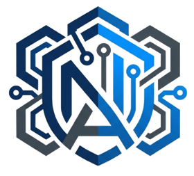

<div align="center">


<a href="https://github.com/jhonathanms">
  
</a>

<p>
  <a href="https://jhonathan-martins.wsstudio.site/"></a>
  <a href="https://www.linkedin.com/in/jhonathan-martins-5b1237143/"></a>
  <a href="https://www.instagram.com/jhonathan.martiins/"></a>
  
</p>

</div>

##  Olá, eu sou o Jhonathan

Há mais de **9 anos** transformo operações reais — estoque, compras, custos, fiscal e agro — em **produtos SaaS**.
Trabalho com **engenharia orientada a especificação**: requisitos e contratos antes do código, arquitetura com decisões registradas e validação em cada etapa.

```yaml
jhonathan:
  agora:      "Engenheiro de software na Alterdata · 7+ anos"
  fundador:   ["Antech Software", "Stocka"]
  site:       "https://jhonathan-martins.wsstudio.site/"
  local:      "Itabuna, Bahia · Brasil · remoto"
  metodo:     [Spec-Driven Development, DDD, Event-driven, ADR]
  estudando:  [LLMs, RAG, agentes com MCP, evals e guardrails]
  idiomas:    { portugues: nativo, ingles: "A2+ → B1" }
```

<table>
  <tr>
    <td align="center" width="25%"><h2>9+</h2><sub>anos construindo software</sub></td>
    <td align="center" width="25%"><h2>7+</h2><sub>anos de Alterdata</sub></td>
    <td align="center" width="25%"><h2>2</h2><sub>startups fundadas</sub></td>
    <td align="center" width="25%"><h2>18+</h2><sub>domínios na minha infra</sub></td>
  </tr>
</table>

##  Produtos que construí

<table>
  <tr>
    <td width="50%" valign="top">
      &nbsp;&nbsp;<b>Stocka</b> <br/>
      &nbsp;&nbsp;<sub>SaaS de inteligência de estoque, compras e custos</sub>
      <br clear="left"/><br/>
      Cotação com portal do fornecedor, mapa comparativo, pedidos, alçadas e integração com PDVs. Lançamentos por voz via WhatsApp.<br/><br/>
         
    </td>
    <td width="50%" valign="top">
      &nbsp;&nbsp;<b>Spice</b> <br/>
      &nbsp;&nbsp;<sub>Ecossistema completo de food service</sub>
      <br clear="left"/><br/>
      PDV, autoatendimento, autopagamento, comanda eletrônica, KDS e hub de delivery com iFood, Zé Delivery, Keeta, Anota AI e 99Food.<br/><br/>
         
    </td>
  </tr>
  <tr>
    <td width="50%" valign="top">
      &nbsp;&nbsp;<b>ERP4me.one</b> <br/>
      &nbsp;&nbsp;<sub>ERP SaaS para pequenas e médias empresas</sub>
      <br clear="left"/><br/>
      Movimentações, financeiro, emissão de NF-e, NFC-e e NFS-e e integração direta com os sistemas dos contadores.<br/><br/>
         
    </td>
    <td width="50%" valign="top">
      &nbsp;&nbsp;<b>Sagri</b> <br/>
      &nbsp;&nbsp;<sub>Da balança ao balanço — gestão agrícola</sub>
      <br clear="left"/><br/>
      Pesagem com tara, umidade e peso líquido, contratos, estoque de grãos e financeiro do produtor em um só lugar.<br/><br/>
        
    </td>
  </tr>
  <tr>
    <td width="50%" valign="top">
      &nbsp;&nbsp;<b>Núcleo Admin</b> <br/>
      &nbsp;&nbsp;<sub>Hub de licenciamento e operação SaaS</sub>
      <br clear="left"/><br/>
      Controle de licenciamento, MRR e distribuição de versões para todos os clientes.<br/><br/>
        
    </td>
    <td width="50%" valign="top">
      &nbsp;&nbsp;<b>SGF</b> <br/>
      &nbsp;&nbsp;<sub>Gestão de filarmônicas e escolas de música</sub>
      <br clear="left"/><br/>
      Integrantes, naipes, frequência em ensaios e apresentações.<br/><br/>
      <a href="https://sgf.antechsoftware.com.br"></a>
    </td>
  </tr>
</table>

##  Stack

<div align="center">

**Backend & dados**<br/>


**Frontend**<br/>


**Cloud & DevOps**<br/>


</div>

```diff
+ Engenharia   Spec-Driven Development · DDD · Event-driven · ADR · Clean Code · Code review
+ AWS          EKS · EC2 · S3 · RDS · SQS · CloudWatch · X-Ray
+ Plataforma   OpenShift · Compose · Caddy · DataDog · Flyway
```

##  IA aplicada

> Acompanho e testo de perto a evolução da IA para entender onde ela gera valor real em produto — com critério de engenharia, custo e confiabilidade.

| 🧠 LLMs | 📚 RAG | 🤖 Agentes & MCP | 🛡️ Evals & guardrails | 🎙️ IA em produto |
|:-:|:-:|:-:|:-:|:-:|
| contexto, custo e escolha de modelo | embeddings, chunking e reranking | function calling com escopo claro | regressão de prompts e saída estruturada | voz → JSON e leitura de notas fiscais |

##  Atividade

<div align="center">


<picture>
  <source media="(prefers-color-scheme: dark)" srcset="https://raw.githubusercontent.com/jhonathanms/jhonathanms/output/snake-dark.svg" />
  
</picture>

</div>

##  O que me formou

- 🎓 **Bacharelado em Sistemas de Informação**
- 🎓 **Pós-graduação em Engenharia de Software**
- 📖 *Domain-Driven Design* · *Designing Data-Intensive Applications* · *Clean Code* · *O Programador Pragmático* · *Criando Microsserviços*

<div align="center">

<br/>

**Bora construir algo juntos?** 👇

<a href="https://jhonathan-martins.wsstudio.site/"></a>
<a href="https://www.linkedin.com/in/jhonathan-martins-5b1237143/"></a>


</div>
